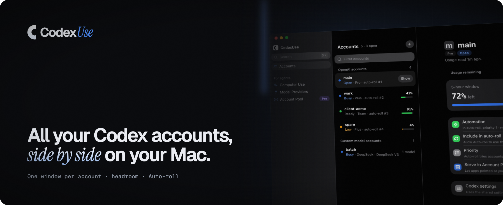
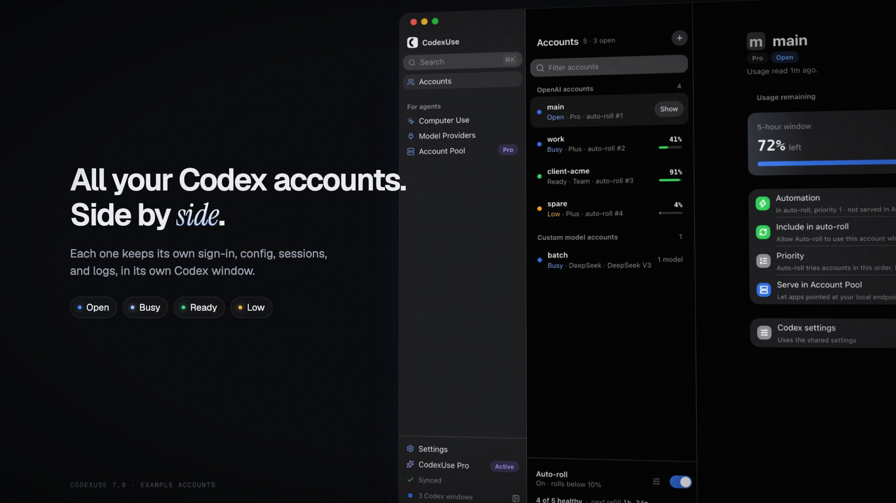
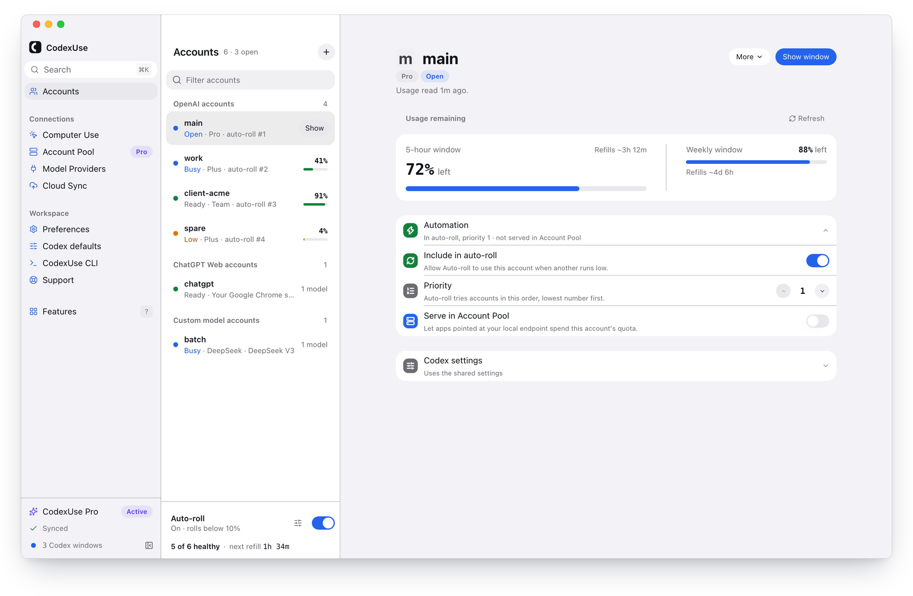
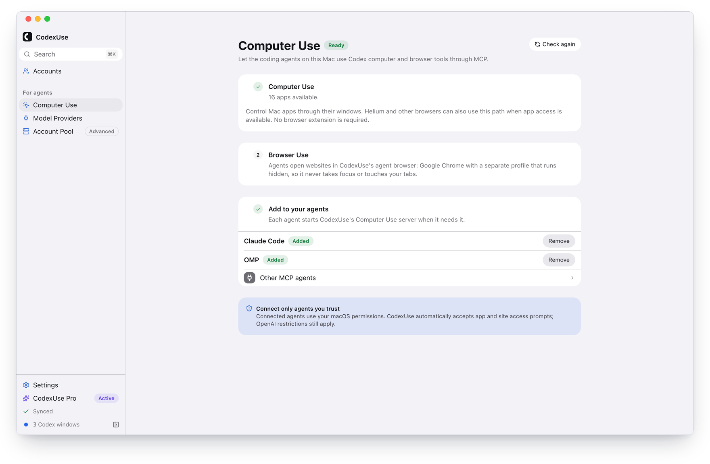

  

  
  
  

  <a href="https://github.com/hweihwang/codexuse-desktop-releases/releases/latest/download/stable-macos-arm64-CodexUse.dmg"><b>Download for Mac</b></a> ·
  <a href="https://codexuse.com"><b>Website</b></a> ·
  <a href="https://codexuse.com/docs/"><b>Docs</b></a>

All your Codex accounts, side by side on your Mac. Personal, work and Business workspaces each get their own window of the official Codex app. CodexUse shows which account has headroom, and you keep working when one runs out.

This repository holds the public downloads and the issue tracker. It does not contain the app source. CodexUse is independent and not affiliated with OpenAI.

  
   
  <a href="https://codexuse.com/#film">Watch the film</a>

## Accounts: every account in its own home

<picture>
  <source media="(prefers-color-scheme: dark)" srcset=".github/assets/accounts-dark.png">
  
</picture>

- **One Codex window per account**, side by side. Open starts it, Show brings it to the front, and no account signs another out.
- **Status in one word:** Open, Busy, Ready, Low, Needs sign-in, Needs setup.
- **Headroom and refill timers** as Codex reports them. CodexUse can start refill timers automatically with a short background request; that does not add quota or speed up refill times.
- **Auto-roll** moves new work to the next account below a threshold you set. It does not move a running conversation.
- **Find task** searches local Codex tasks across accounts and opens each one in the account that owns it.
- **Shared Codex defaults** with small per-account overrides.

## For agents

<picture>
  <source media="(prefers-color-scheme: dark)" srcset=".github/assets/computer-use-dark.png">
  
</picture>

- **Computer Use** lets Claude Code, OMP, and other MCP agents control Mac apps through OpenAI's Computer Use runtime, and open websites in CodexUse's agent browser: Google Chrome with its own profile, running in the background so it never touches your windows. Import cookies from your browser so agents start signed in. Their own model decides every action, and CodexUse approves each app and site for them, so there are no approval prompts. Add the server only to agents you trust. CodexUse → Computer Use installs the runtime, copying it from ChatGPT or Codex Desktop when you have one. It needs Apple Silicon macOS, and Google Chrome for websites. This is not an official OpenAI integration, and the runtime can change with any OpenAI update.
- **Model Providers** run OpenRouter, DeepSeek, Groq, or a local model inside the Codex app as their own account. You pay the provider directly, and dictation and browser control are unavailable on them.
- **Account Pool** (advanced) serves selected accounts to another OpenAI-compatible app as one local API, with load balancing and failover. It runs on your computer and does not raise any account's limit.

## Download and install

Requires macOS 13 or later on Apple Silicon. Download [`stable-macos-arm64-CodexUse.dmg`](https://github.com/hweihwang/codexuse-desktop-releases/releases/latest/download/stable-macos-arm64-CodexUse.dmg) or run `brew install --cask hweihwang/codexuse/codexuse`. The app updates itself; Homebrew installs update with `brew upgrade --cask codexuse`. Intel Macs are not supported.

On macOS, open the disk image and drag CodexUse into Applications. If macOS reports a damaged or unverified download, stop and follow the [troubleshooting guide](https://codexuse.com/docs/troubleshooting/). Do not turn off macOS security checks.

CodexUse also runs on Windows 11 x64 and Ubuntu 24.04 with fewer features: one Codex window per account, Auto-roll, Find task, and Computer Use need macOS. The packages are on the [releases page](https://github.com/hweihwang/codexuse-desktop-releases/releases/latest), and [platform support](https://codexuse.com/docs/desktop/) lists what runs where. The separate [CLI](https://codexuse.com/docs/cli/) installs with `npm install -g codexuse-cli`; it does not have every desktop feature.

OpenAI accounts sign in with the Codex CLI OAuth flow and need no OpenAI API key. Custom-model accounts use a provider credential that you supply.

## Trial and Pro

Try every app feature for 7 days. After that, features lock until a Pro license is activated. Nothing is deleted, and there is no permanent free tier.

Pro is a one-time lifetime license for up to 5 computers: $39 regular price, currently $19.50 with the code CODEXUSE50. There is a 30-day refund window. Account quotas and provider charges stay separate.

Buy inside CodexUse to activate automatically. If you buy on the website, enter the license key from your Gumroad receipt in CodexUse. If you already paid, do not buy again.

## Links

[Website](https://codexuse.com/) · [Getting started](https://codexuse.com/docs/getting-started/) · [Accounts](https://codexuse.com/docs/accounts/) · [Platforms](https://codexuse.com/docs/desktop/) · [Release notes](https://codexuse.com/releases/) · [Report an issue](https://github.com/hweihwang/codexuse-desktop-releases/issues)
